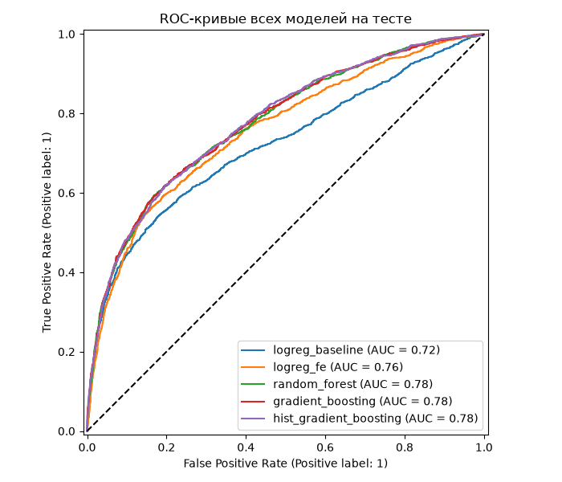

# PD-модель: предсказание дефолта по кредитным картам

Итоговый проект по дисциплине «Автоматизация процессов разработки и тестирования моделей машинного обучения».

Задача: по данным клиента кредитной карты предсказать вероятность дефолта в следующем месяце.
Данные: [Default of Credit Card Clients](https://archive.ics.uci.edu/dataset/350/default+of+credit+card+clients)
(UCI, в проекте используется CSV-версия с Kaggle), 30 000 клиентов из Тайваня, 23 признака,
дефолтов около 22%.

В проекте собран весь путь модели: проверка и подготовка данных, обучение с подбором гиперпараметров,
логирование экспериментов в MLflow, DVC-пайплайн, тесты и CI в GitHub Actions, REST API в Docker
и мониторинг дрифта.

## Результаты

Проведено пять экспериментов, лучшая модель выбиралась по ROC-AUC на кросс-валидации (5 фолдов),
тестовая выборка использовалась только для итоговой оценки.

| Эксперимент | CV ROC-AUC | Test ROC-AUC | Gini | Precision | Recall | F1 |
|---|---|---|---|---|---|---|
| **hist_gradient_boosting** | **0.788** | 0.777 | 0.555 | 0.503 | 0.575 | 0.537 |
| gradient_boosting | 0.788 | 0.777 | 0.554 | 0.519 | 0.561 | 0.539 |
| random_forest | 0.787 | 0.775 | 0.551 | 0.529 | 0.534 | 0.531 |
| logreg_fe | 0.763 | 0.757 | 0.514 | 0.480 | 0.574 | 0.523 |
| logreg_baseline | 0.726 | 0.719 | 0.438 | 0.555 | 0.447 | 0.495 |

Что видно из экспериментов:

- новые признаки дают логистической регрессии +0.04 ROC-AUC (`logreg_baseline` → `logreg_fe`);
- три ансамбля почти не отличаются, выбран HistGradientBoosting: лучший CV и обучается
  в 5–7 раз быстрее остальных;
- разница между CV и тестом около 0.01, переобучения не видно;
- порог классификации подобран по F1 на out-of-fold предсказаниях train (0.264 для итоговой модели),
  при пороге 0.5 recall был бы заметно ниже.



## Структура проекта

```
├── .github/workflows/ci-cd.yml   # CI: flake8, black, валидация GE, pytest
├── data/
│   ├── raw/                      # исходный датасет (под DVC)
│   ├── processed/                # train.csv, test.csv (выход стадии prepare)
│   └── expectations/             # набор правил Great Expectations в json
├── models/                       # model.pkl (под DVC) и model_meta.json с порогом
├── notebooks/01_eda.ipynb        # разведочный анализ
├── reports/                      # таблица экспериментов, графики, отчёты валидации и дрифта
├── scripts/
│   ├── build_and_run.sh          # сборка образа и запуск API
│   └── sample_request.json       # пример запроса к /predict
├── src/
│   ├── data/
│   │   ├── columns.py            # названия колонок
│   │   ├── make_dataset.py       # загрузка, очистка, train/test split
│   │   └── validation.py         # правила Great Expectations
│   ├── features/build_features.py
│   ├── models/
│   │   ├── pipeline.py           # sklearn Pipeline
│   │   ├── metrics.py            # метрики и подбор порога
│   │   ├── train.py              # подбор гиперпараметров + MLflow
│   │   └── predict.py            # инференс
│   ├── api/app.py                # FastAPI
│   └── monitoring/
│       ├── drift.py              # расчёт PSI
│       └── monitor.py            # имитация потока данных в API и отчёт по дрифту
├── tests/                        # pytest, tests/data/sample.csv - 1000 строк датасета
├── dvc.yaml, dvc.lock, params.yaml
├── Dockerfile
└── requirements*.txt             # api - для образа, основной - для обучения, dev - всё вместе
```

## Быстрый старт

Нужны Python 3.14 и Docker.

```bash
git clone https://github.com/orenkant/MIFI_Track2_itog.git
cd MIFI_Track2_itog
python -m venv .venv
source .venv/bin/activate
pip install -r requirements-dev.txt
```

### Данные

Датасет и модель версионируются через DVC и в git не лежат. Хранилище DVC у меня локальное,
поэтому после клонирования с GitHub `dvc pull` не сработает, датасет нужно скачать вручную:

1. Скачать `UCI_Credit_Card.csv` с Kaggle:
   [Default of Credit Card Clients Dataset](https://www.kaggle.com/datasets/uciml/default-of-credit-card-clients-dataset)
   (кнопка Download, в архиве один файл) или через Kaggle CLI:

   ```bash
   kaggle datasets download -d uciml/default-of-credit-card-clients-dataset -p data/raw --unzip
   ```

2. Положить файл в `data/raw/UCI_Credit_Card.csv`.
3. По желанию сверить хеш с `data/raw/UCI_Credit_Card.csv.dvc`:

   ```bash
   md5sum data/raw/UCI_Credit_Card.csv   # 940b416bb13a9b24bb5c9e1589284005
   ```

4. Собрать пайплайн, подготовленные данные и модель появятся заново:

   ```bash
   dvc repro     # validate -> prepare -> train, около 3.5 минут
   ```

Если хеш не совпал (например, другие переводы строк), `dvc repro` всё равно отработает:
DVC увидит, что данные изменились, а стадия `validate` проверит, что с ними всё в порядке.

При доступе к хранилищу DVC вместо шагов 1–4 достаточно `dvc pull`.

## Данные и валидация

Очистка (`src/data/make_dataset.py`):

- удаляется `ID`, таргет переименован в `target`;
- недокументированные коды `EDUCATION` (0, 5, 6) объединены с «прочее» (4), `MARRIAGE = 0` – с 3;
- удалены 35 полных дублей;
- отрицательные `BILL_AMT*` оставлены: это переплата, а не ошибка;
- train/test 80/20 со стратификацией по таргету.

Валидация (`src/data/validation.py`, Great Expectations 1.x) – 100 проверок:
наличие всех колонок, отсутствие пропусков, типы, допустимые коды категорий и `PAY_*`,
бизнес-диапазоны (`AGE` 18–100, `LIMIT_BAL > 0` и т.д.), уникальность `ID`, таргет только 0/1.
Если хоть одна проверка не прошла, скрипт завершается с кодом 1 и DVC-пайплайн дальше не идёт.

```bash
python -m src.data.validation data/raw/UCI_Credit_Card.csv
```

Тесты в `tests/test_validation.py` специально портят данные (null, `AGE=150`, неизвестная категория,
неверный таргет, пропавшая колонка, дубль `ID`) и проверяют, что валидация падает.

## Feature Engineering

`src/features/build_features.py`, считается построчно, поэтому утечки из теста нет:

| Признак | Что это |
|---|---|
| `MONTHS_DELAYED` | число месяцев с просрочкой из 6 |
| `MAX_DELAY` | максимальная просрочка |
| `UTILIZATION` | `BILL_AMT1 / LIMIT_BAL`, загрузка лимита |
| `BILL_MEAN`, `PAY_AMT_MEAN` | средний счёт и средний платёж |
| `PAY_RATIO` | доля оплаты от суммы счетов (если долга нет – 1) |
| `AGE_BIN` | возрастные группы: <25, 25-34, ..., 65+ |

`MONTHS_DELAYED` и `MAX_DELAY` коррелируют с таргетом сильнее любого исходного признака
(0.39 и 0.37 против 0.29 у `PAY_0`), подробнее в `notebooks/01_eda.ipynb`.

## Модель и MLflow

Pipeline (`src/models/pipeline.py`): `FunctionTransformer(add_features)` → `ColumnTransformer`
(числовые: `SimpleImputer` + `StandardScaler`, категориальные: `SimpleImputer` + `OneHotEncoder`) →
классификатор. Признаки считаются внутри Pipeline, поэтому API принимает сырые данные.

Гиперпараметры подбираются через `GridSearchCV` / `RandomizedSearchCV`, сетки лежат в `params.yaml`.

В MLflow для каждого эксперимента пишутся параметры, метрики CV и теста (ROC-AUC, Gini, PR-AUC,
Precision, Recall, F1, Accuracy), артефакты (ROC-кривая, матрица ошибок, важность признаков,
результаты подбора, classification report) и сама модель через `mlflow.sklearn.log_model`.
Лучшая модель регистрируется как `CreditDefaultModel` с алиасом `champion`.

```bash
mlflow ui --backend-store-uri sqlite:///mlflow.db
# http://127.0.0.1:5000
```

## DVC

```
data/raw/UCI_Credit_Card.csv.dvc
          │
       validate      проверка GE, при ошибке пайплайн останавливается
          │
       prepare       очистка и train/test split
          │
        train        5 экспериментов, лучшая модель -> models/model.pkl, metrics.json
```

```bash
dvc repro           # пересчитать только то, что изменилось
dvc dag             # граф стадий
dvc metrics show    # метрики лучшей модели
dvc params diff     # что поменялось в params.yaml
dvc push / dvc pull
```

Хранилище DVC – локальная папка рядом с проектом. Для учебного проекта этого достаточно,
в команде здесь был бы общий remote (S3, Google Drive), а пока данные берутся с Kaggle,
см. [Данные](#данные).

## Тесты и CI

```bash
pytest              # 61 тест
flake8 src tests
black --check src tests
```

Покрыты очистка данных, признаки, валидация, метрики, Pipeline, инференс, API и расчёт PSI.

GitHub Actions (`.github/workflows/ci-cd.yml`) на каждый push и pull request:

1. `lint` – flake8 и black;
2. `test` – валидация данных через Great Expectations и pytest, отчёт валидации сохраняется
   как артефакт.

Полный датасет лежит в DVC и из GitHub недоступен, поэтому в CI валидируется выборка
`tests/data/sample.csv` (1000 строк исходных данных). Модель для тестов API обучается прямо в тесте.

## Docker и API

```bash
./scripts/build_and_run.sh
```

Скрипт собирает образ (`python:3.14-slim`, только зависимости для инференса), запускает контейнер
на порту 8000, ждёт готовности и отправляет проверочный запрос. Документация API: http://localhost:8000/docs

| Метод | Путь | Что делает |
|---|---|---|
| GET | `/` | проверка, что сервис жив |
| GET | `/health` | статус, имя модели и порог |
| POST | `/predict` | предсказание для одного клиента |
| POST | `/predict_batch` | предсказание для списка клиентов |

```bash
curl -X POST http://localhost:8000/predict \
     -H "Content-Type: application/json" \
     -d @scripts/sample_request.json
# {"default_prediction":1,"default_probability":0.7613180884886573}
```

Класс определяется по порогу из обучения, а не по 0.5. Входные данные проверяются Pydantic
по тем же границам, что и в Great Expectations: некорректные значения, пропущенные или лишние поля
возвращают 422.

## Мониторинг дрифта

`src/monitoring/monitor.py` берёт часть тестовой выборки как «новых клиентов», проверяет её
через Great Expectations, отправляет в API и считает PSI относительно train для ключевых признаков
и для предсказанных вероятностей. Пороги: < 0.1 – stable, 0.1–0.25 – moderate, ≥ 0.25 – significant.

```bash
# API должен быть запущен
python -m src.monitoring.monitor                                 # обычный поток
python -m src.monitoring.monitor --drift --fail-on-drift \
       --report reports/drift_report_shifted.json                 # со сдвигом
```

Режим `--drift` имитирует сдвиг: в поток попадает половина клиентов с просрочкой
(в train их около 23%), и лимиты снижены на 30%. С `--fail-on-drift` при сильном дрифте скрипт
возвращает код 1, это можно использовать как триггер на переобучение.

| | Обычный поток | Со сдвигом |
|---|---|---|
| PSI `LIMIT_BAL` | 0.010 stable | 0.558 significant |
| PSI `PAY_0` | 0.016 stable | 0.338 significant |
| PSI `PAY_2` | 0.011 stable | 0.149 moderate |
| PSI вероятностей | 0.010 stable | 0.235 moderate |
| Доля предсказанных дефолтов | 0.259 → 0.248 | 0.259 → 0.448 |
| Фактическая доля дефолтов | 0.221 → 0.216 | 0.221 → 0.289 |
| Итог | stable | significant |

Отчёты сохраняются в `reports/drift_report.json` и `reports/drift_report_shifted.json`.

## Замечания

- В лекции Great Expectations показан на версии 0.18, здесь используется 1.x: API другой
  (`ExpectationSuite`, `ValidationDefinition`), смысл проверок тот же.
- MLflow 3 сохраняет sklearn-модели через skops, поэтому в `train.py` явно перечислены
  доверенные типы.
- В режиме `--drift` лимиты меняются искусственно, а метки остаются прежними, поэтому модель
  переоценивает долю дефолтов (0.45 против фактических 0.29). ROC-AUC на сдвинутом потоке
  тоже нельзя напрямую сравнивать с тестом: другой состав клиентов.
